<div align="center">


# Che mi metto?

**La web app che ti dice cosa indossare guardando il meteo, i tuoi impegni e il tuo armadio.**

[](https://github.com/amazzotti/che-mi-metto/actions/workflows/ci.yml)


[](LICENSE)

[English summary](#english-summary) · [Provala](https://amazzotti.github.io/che-mi-metto/)

</div>

<p align="center">
  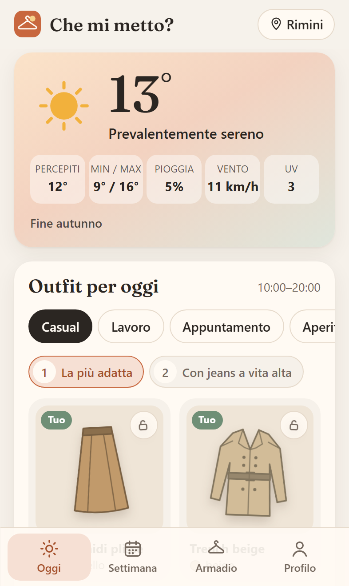
  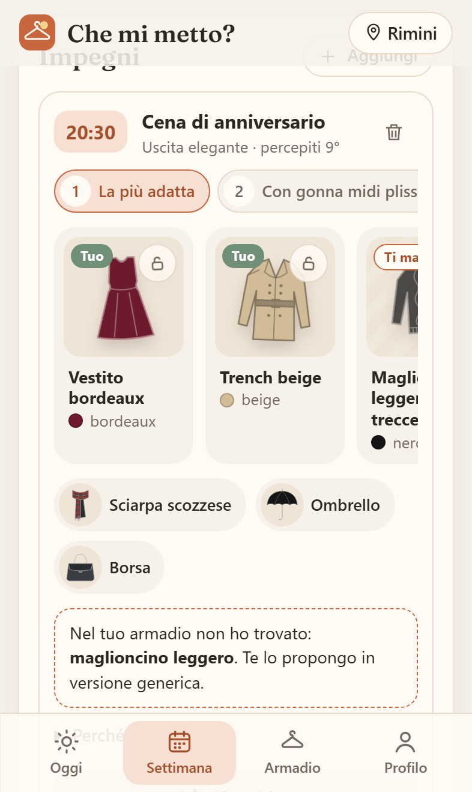
  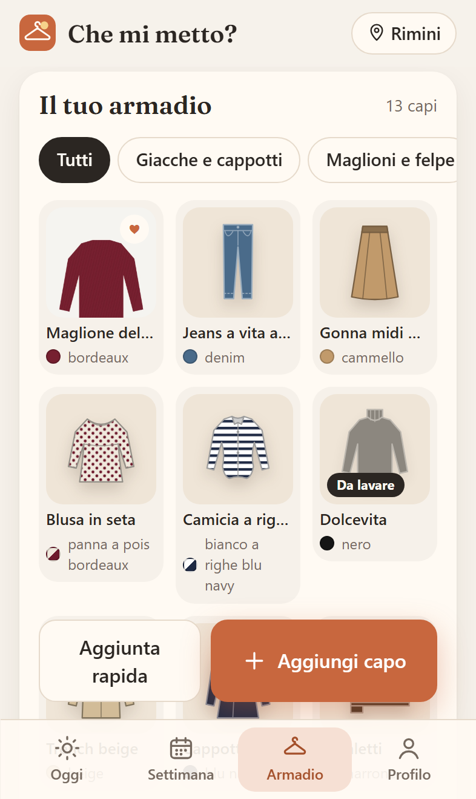
  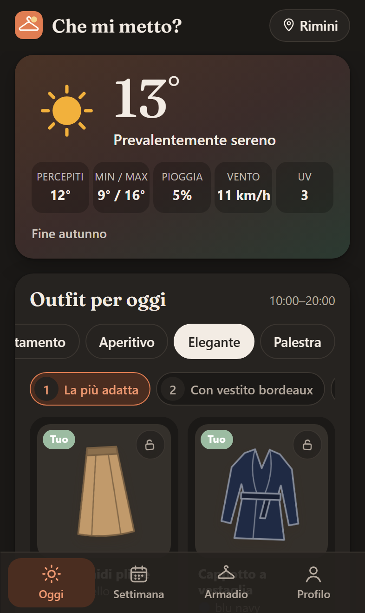
</p>

## L'idea

Ogni mattina la stessa domanda: *che mi metto?* L'app guarda il meteo del posto in cui sei (adesso, nelle prossime ore e nei
prossimi giorni), la stagione e i tuoi impegni, e ti propone un outfit completo: dalla maglia alle scarpe, fino a ombrello e
occhiali da sole. Se carichi i tuoi vestiti, i consigli usano quelli e ti dicono cosa ti manca.

È una **web app installabile (PWA)**: si apre da Safari o Chrome e si aggiunge alla schermata Home come un'app vera, anche su
iPhone, senza passare dall'App Store.

## Cosa fa

- 🌦️ **Meteo del luogo in cui sei**: posizione dal GPS del telefono oppure ricerca della città. Temperatura reale e
  percepita, pioggia, vento, indice UV e previsioni a 7 giorni.
- 👗 **Outfit completo per uomo o donna**: maglia, strato, capospalla, pantaloni/gonna o vestito, scarpe e accessori, con i
  colori giusti per la stagione.
- 📅 **Impegni e occasioni**: casual, lavoro, appuntamento, aperitivo, uscita elegante, palestra. Ogni impegno ha il suo
  outfit calcolato sul meteo **di quell'ora** (la cena delle 20:30 non è il pranzo delle 13). Per la palestra c'è anche la
  lista di cosa mettere in borsa.
- 🧥 **Armadio digitale**: carichi i capi uno per uno, con una foto o scegliendo solo tipo e colore. Il colore viene
  riconosciuto dalla foto. I consigli usano i tuoi vestiti, abbinano i colori e segnalano cosa manca.
- 🎨 **Sagome disegnate a mano, diverse per donna e uomo**: t-shirt aderente od oversize, blazer sciancrato, cappotto a
  vestaglia, jeans skinny o a zampa, gonna a tubino o a ruota, vestito a sottoveste… Ogni capo ha il suo colore e, se vuoi,
  una fantasia (righe, quadri, pois, fiori) con un secondo colore. Nelle idee generiche l'app aggiunge da sola un capo
  fantasia adatto a stagione e occasione: fiori in primavera, quadri in autunno, niente fantasie in palestra.
- 🔄 **Tre idee diverse da sfogliare** per ogni giornata e ogni impegno, con un titolo che dice cosa cambia ("Con jeans a
  zampa", "Più elegante"…), e **"Altre idee"** per continuare. Le proposte **cambiano da un giorno all'altro** e per la
  donna includono sempre anche gonne, vestiti, top e ballerine.
- 🔒 **Lucchetto**: fissi un capo che ti piace (o che vuoi mettere per forza) e sfogli le idee costruite intorno a lui.
  Dall'armadio, **"Abbinalo"** apre gli outfit di oggi già con quel capo.
- ⚡ **Aggiunta rapida**: scegli un colore e tocchi le sagome dei capi che hai: l'armadio è pronto in due minuti, senza
  foto. Per ogni capo puoi scegliere anche il **modello** (es. jeans skinny o a zampa).
- 🌡️ **"Ieri com'era?"**: la mattina dopo ti chiede se avevi freddo o caldo e corregge da sola, di mezzo grado alla
  volta, la temperatura su cui ragiona.
- 👕 **Oltre 60 tipi di capi** per uomo e donna, dal gilet al parka, dalla tuta intera ai pantaloni palazzo, ognuno con un
  livello di **formalità**: nello stesso outfit non finiscono mai capi che stonano.
- ♥ **Preferiti, "da lavare" e "Lo metto oggi"**: i preferiti escono più spesso, i capi in lavatrice no, e quello che hai
  messo oggi non te lo ripropone domani. **Statistiche**: quanto dell'armadio usi, i capi più messi e quelli da
  riscoprire. **Sensibilità al freddo** personale (freddoloso / nella media / caloroso).
- 📴 **Funziona offline** con le ultime previsioni salvate, **tema chiaro e scuro**, interfaccia pensata per il pollice.
- 🔒 **Privacy**: nessun account e nessun server. Profilo, foto e impegni restano sul telefono; backup e ripristino con un
  file.

## Come ragiona il motore

Il cuore è [`src/features/outfit/motore.ts`](src/features/outfit/motore.ts): regole semplici, deterministiche e coperte da
test.

1. La **temperatura percepita** nelle ore che contano (la giornata 8-20, oppure attorno all'ora dell'impegno), corretta di
   ±3° per chi soffre il freddo o il caldo, decide la **fascia climatica**:

   | Fascia | Percepiti | Esempio |
   |---|---|---|
   | Gelo | < 3° | piumino, maglione, sciarpa, berretto, guanti |
   | Freddo | 3-9° | cappotto e maglione |
   | Fresco | 9-15° | felpa o maglione e una giacca |
   | Mite | 15-20° | giacca leggera fino a 18°, maniche lunghe; giacca per la sera |
   | Tiepido | 20-25° | maniche corte o camicia |
   | Caldo | 25-30° | lino, gonne, bermuda, sandali |
   | Torrido | ≥ 30° | il minimo indispensabile, colori chiari |

   Regole fisse: **maglione o felpa sotto i 15°**, **giacca fino a 18°**, **maniche corte da sole solo sopra i 18°**.
2. La fascia dice quali capi sono adatti per ogni parte dell'outfit; l'**occasione** li ordina per preferenza. Ogni capo ha
   una **formalità da 1 a 5** e non può allontanarsi di più di due gradini dagli altri capi scelti.
3. **Pioggia, neve, vento, sole e sbalzi** di temperatura aggiungono correzioni: capi impermeabili, scarpe chiuse, ombrello
   (pieghevole già dal 25% di pioggia), niente bermuda con il vento forte, occhiali, uno strato da togliere.
4. Con l'**armadio** ogni capo riceve un punteggio: adatto all'occasione, ripara dalla pioggia, sta bene con i colori già
   scelti, formalità coerente, preferito, non messo ieri; i capi da lavare sono esclusi. Senza armadio si usa una **palette
   di stagione**, con al massimo un capo **fantasia** per outfit e un secondo colore che stacca dal fondo.
5. Il motore genera nove varianti e ne tiene **tre il più possibile diverse** (somiglianza di Jaccard tra capi e colori).
   Il punto di partenza dipende dal giorno, quindi le proposte cambiano ogni giorno ma restano stabili nella giornata. I capi
   fissati con il **lucchetto** restano in tutte le varianti; la **correzione personale** imparata da "Ieri com'era?"
   sposta la temperatura su cui ragiona.
6. Ogni consiglio arriva con il **perché**: *"Percepiti 8°: fa freddo. Pioggia probabile (80%): capi che riparano, scarpe
   chiuse e ombrello."*

Prima di scriverlo ho studiato il codice di otto app open source di outfit e armadio digitale e il funzionamento delle app
commerciali più usate (Whering, Acloset, Stylebook, Cladwell, app meteo-outfit): cosa ho imparato da ciascuna, con le
licenze, è in [docs/ISPIRAZIONI.md](docs/ISPIRAZIONI.md).

<p align="center">
  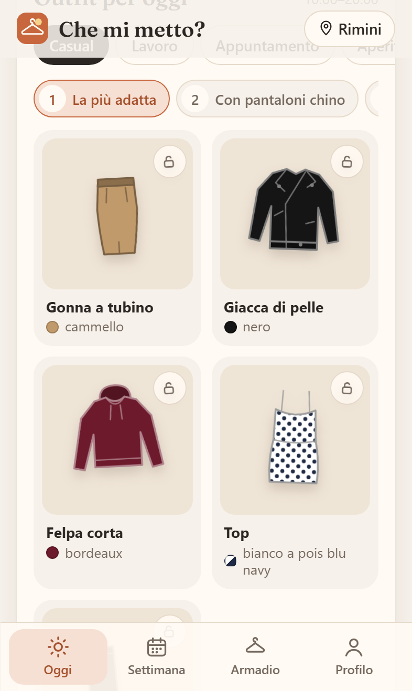
  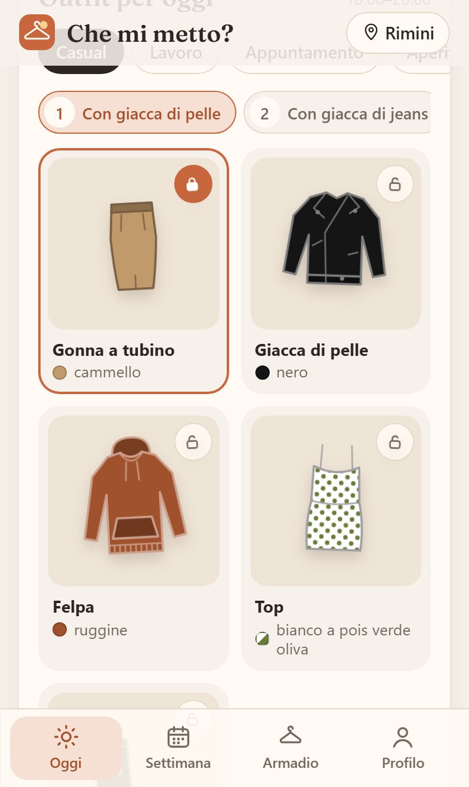
  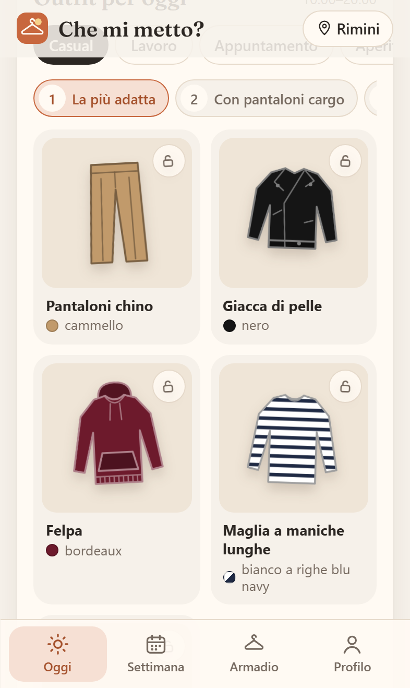
  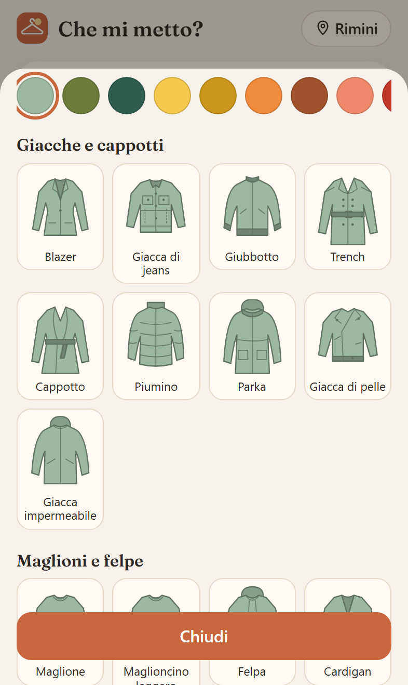
</p>
<p align="center">
  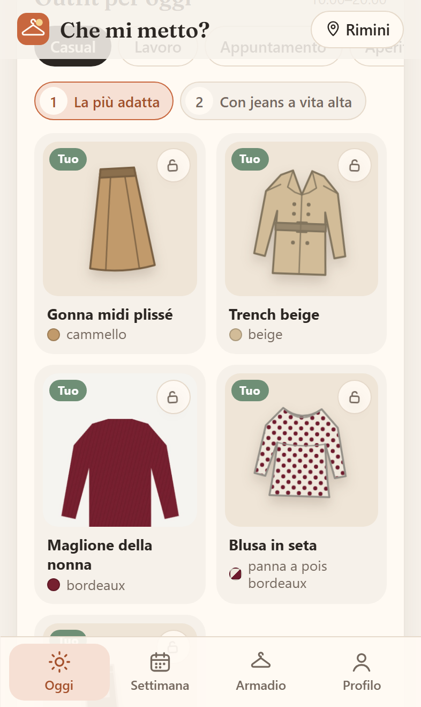
  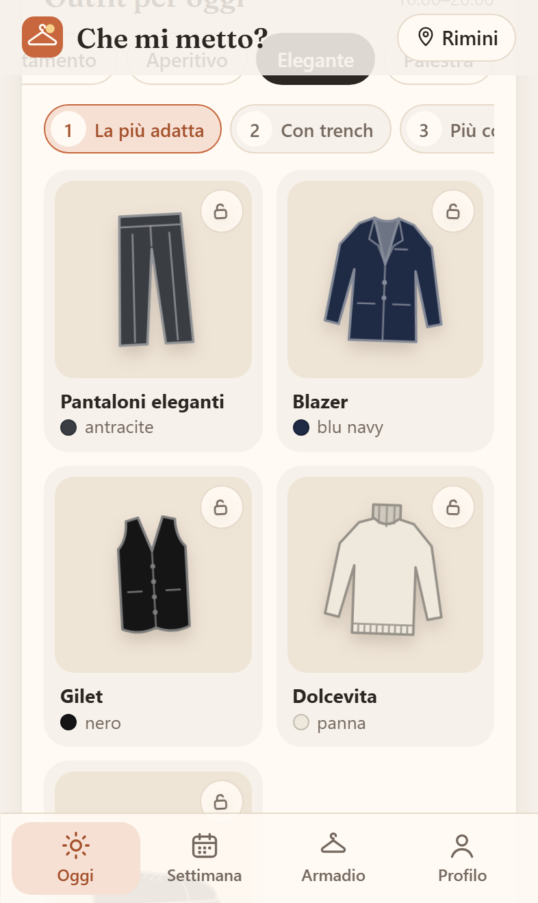
  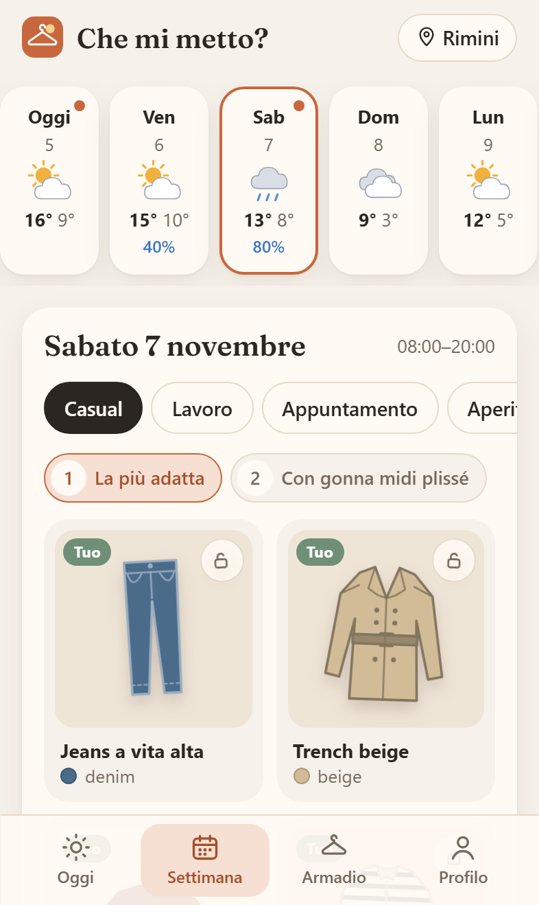
  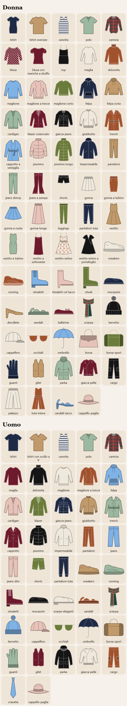
</p>

## Tecnologie

| Cosa | Scelta |
|---|---|
| Interfaccia | React 19 + TypeScript (strict) + Vite |
| App installabile | vite-plugin-pwa (Workbox): manifest, icone, service worker, funzionamento offline |
| Meteo | [Open-Meteo](https://open-meteo.com/) (gratuito, senza chiave) + ricerca città di Open-Meteo |
| Nome del luogo dal GPS | [Nominatim](https://nominatim.org/) di OpenStreetMap |
| Dati sul dispositivo | IndexedDB con Dexie |
| Grafica | CSS con variabili, tema chiaro/scuro, sagome SVG disegnate a mano, font Fraunces |
| Test | Vitest + Testing Library (unitari e componenti), Playwright (end-to-end su WebKit e Chromium) |
| CI/CD | GitHub Actions: lint, tipi, test con copertura, build, e2e; pubblicazione su GitHub Pages |

**Costo: 0 €.** Nessuna chiave API, nessun database a pagamento, hosting gratuito su GitHub Pages.

## Installarla sull'iPhone

1. Apri il link con **Safari**.
2. Tocca **Condividi** e poi **Aggiungi alla schermata Home**.
3. Si apre a tutto schermo come un'app. Da installata, iOS conserva meglio i dati salvati.

Su Android: Chrome propone da solo "Installa app".

## Struttura

```
src/
├─ app/                 guscio dell'app: navigazione, primo avvio, stile
├─ features/
│  ├─ meteo/            Open-Meteo, posizione, stagioni, icone meteo
│  ├─ outfit/           catalogo dei capi, motore, colori, sagome SVG
│  ├─ armadio/          capi, foto (ridimensionamento e colore dominante)
│  ├─ impegni/          impegni del giorno
│  ├─ giornata/         pagine Oggi e Settimana
│  └─ profilo/          profilo, backup, privacy
├─ shared/              database locale, tipi, date, componenti comuni
└─ test/                dati meteo finti condivisi da test unitari ed e2e
e2e/                    test Playwright e generatore delle anteprime
```

Ogni funzione vive nella sua cartella: aggiungerne di nuove (per esempio **spese di casa, lista della spesa e promemoria di
coppia**) vuol dire aggiungere una cartella in `features/`, una voce nella barra in basso e, se servono dati condivisi, un
archivio che parla con un backend, senza toccare il resto.

## Sviluppo

Servono Node.js 22 o più recente.

```bash
npm install
npm run dev          # app in locale su http://localhost:5173
npm test             # test unitari e dei componenti
npm run coverage     # con copertura
npm run e2e          # test end-to-end (prima: npx playwright install chromium webkit)
npm run screenshots  # rigenera le anteprime in docs/screenshots
npm run lint
npm run build
```

I test non dipendono dal meteo vero: [`src/test/meteoFinto.ts`](src/test/meteoFinto.ts) genera risposte di Open-Meteo
realistiche (curva della temperatura, pioggia nel pomeriggio, neve...) usate sia da Vitest sia da Playwright, con l'orologio
fermo a una data precisa. I test end-to-end girano su **WebKit**, il motore di Safari, con lo schermo di un iPhone, e
controllano anche che nessuna pagina scorra in orizzontale.

## Pubblicazione

Ogni push su `main` passa dalla CI; se il repository è pubblico, il workflow
[`pages.yml`](.github/workflows/pages.yml) pubblica l'app su GitHub Pages. La prima volta va scelto
**Settings → Pages → Source: GitHub Actions**.

## Crediti

- Dati meteo: [Open-Meteo.com](https://open-meteo.com/) (CC BY 4.0)
- Nomi dei luoghi: © [OpenStreetMap](https://www.openstreetmap.org/copyright) contributors
- Font: [Fraunces](https://fonts.google.com/specimen/Fraunces) (SIL Open Font License)
- Idee per il motore da progetti open source, senza riusarne il codice: elenco e licenze in
  [docs/ISPIRAZIONI.md](docs/ISPIRAZIONI.md)

## English summary

**Che mi metto?** ("What should I wear?") is an installable **Progressive Web App** that suggests a complete outfit
based on the **weather where you are** (current conditions, hourly and 7-day forecast), the **season**, your **plans for
the day** (work, date, cocktails, formal event, gym) and, optionally, **your own wardrobe**.

- Rule-based, fully tested recommendation engine: perceived temperature bands, rain/snow/wind/UV adjustments, occasion
  preferences, colour harmony scoring and seasonal palettes. Every suggestion explains *why*.
- Digital wardrobe: add items one by one with a photo (resized on device, dominant colour detected automatically) or just
  type, colour and pattern (stripes, checks, polka dots, florals); hand-drawn SVG silhouettes take the item's colours and
  pattern when there is no photo.
- Each event gets an outfit computed on the forecast **for that hour**; the gym gets a "pack in your bag" list.
- **Three swipeable, deliberately different ideas** per day and per event: nine variants are generated and the three with
  the lowest Jaccard similarity are kept. Each of 60+ garment types has a 1–5 **formality** level to keep outfits coherent.
- Gender-specific hand-drawn silhouettes with several models per garment, daily-changing suggestions, a **lock** to keep
  a piece fixed while browsing ideas, "style this piece" from the wardrobe, a quick-add grid, and a daily "how was
  yesterday?" check that self-calibrates the temperature offset.
- Wardrobe extras inspired by open-source projects (see [docs/ISPIRAZIONI.md](docs/ISPIRAZIONI.md)): favourites, "in the
  laundry" items excluded, and an "I'm wearing it today" button that tracks wear count and avoids repeats.
- Privacy by design: no account, no server, everything stays in IndexedDB on the phone, with JSON backup/restore.
- Works offline, light/dark theme, mobile-first UI tested on WebKit (Safari engine) with an iPhone viewport.
- Stack: React 19, TypeScript, Vite, vite-plugin-pwa, Dexie, Vitest, Testing Library, Playwright, GitHub Actions, GitHub
  Pages. Weather from Open-Meteo (free, no API key). **Total running cost: €0.**

## Licenza

[MIT](LICENSE) © 2026 Alessandro Mazzotti
